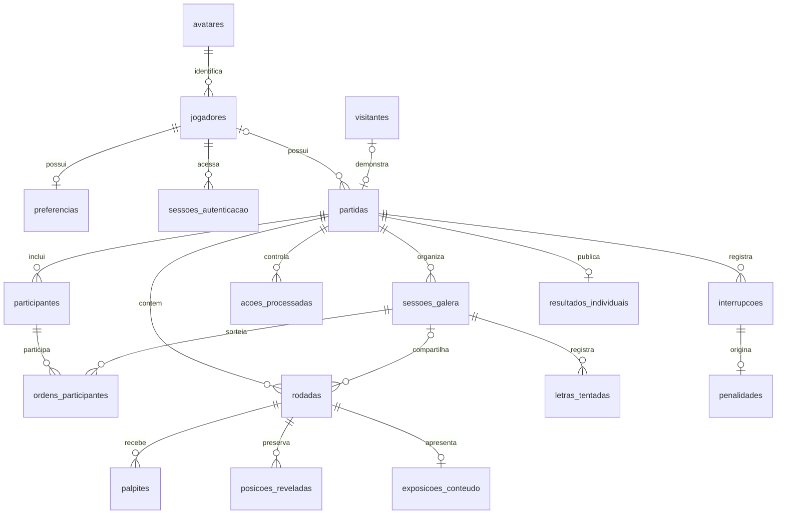

# Modelagem de dados — fase 10

**Atualização da fase 20:** migração `0005_planos_individuais` acrescenta a tabela de configuração confirmável, totalizando 20 tabelas. Planos pertencem ao jogador, guardam somente referências/revisões e expiram para início em dez minutos. Exclusão de conta remove os planos. O motor grava rodadas, exposições, ações, palpites e resultado numa transação; detalhes em [Motor individual](Motor-individual.md).

**Atualização da fase 19:** migração `0004_demonstracao_vinculo` acrescenta `visitantes.demonstracao_id`, único e com chave estrangeira para a partida. Preserva a referência depois de trocar o proprietário visitante por jogador. Mantidas 19 tabelas; perfil, exclusão e catálogo anterior preservados. Prazo, concorrência e limites em [Visitante e demonstração](Demonstracao-visitante.md).

**Atualização da fase 17:** migração `0003_colecao_avatares` popula 20 avatares oficiais, mantendo 19 tabelas. Perfil, preferências e rotina transacional de anonimização estão implementados e testados, conforme [Perfil e preferências](Perfil-preferencias.md). O catálogo de desenvolvimento chegou a 100 respostas aprovadas na fase 16. O estado abaixo preserva o registro das fases anteriores.

**Estado:** modelagem inicial implementada na fase 10; a fase 15 acrescenta tentativas de login de uso único, totalizando 19 tabelas de aplicação e migrações 0001/0002. Estrutura e autenticação verificadas em PostgreSQL isolado de testes. Na fase 12, o catálogo MongoDB recebeu 75 respostas aprovadas em desenvolvimento. PostgreSQL de desenvolvimento configurado na fase 15, com usuário próprio e migrações aplicadas. Login Google real confirmado, com conta pendente e sessão persistidas; operações do jogo permanecem nas fases próprias.

## 1. Divisão dos dados

PostgreSQL armazena identidade, configuração, progresso, ações, resultados e histórico de exposição. MongoDB armazena o conteúdo oficial das respostas e dicas, incluindo versões necessárias às partidas salvas. Não há transação distribuída nem chave estrangeira entre os dois bancos.

Toda referência de conteúdo no PostgreSQL usa o identificador estável e uma revisão de conteúdo. A solução oficial e as cinco dicas não são copiadas para tabelas relacionais. O texto enviado pelo jogador em um palpite é um registro de ação, não uma segunda fonte do catálogo.

Identificadores relacionais: UUID. Datas: instantes UTC com fuso (`timestamptz`), formatados para o usuário na interface. Pontos: inteiros com sinal; nenhum limite mínimo zero para partidas ou rankings. Nomes próprios de campos, índices e restrições em português e sem acentos.

## 2. Entidades relacionais

| Entidade | Responsabilidade e campos principais |
| --- | --- |
| `jogadores` | Identificador, identidade Google estável, e-mail, nome de exibição, chave de unicidade do nome, avatar e instante de cadastro. Nome/avatar ainda podem estar ausentes durante primeiro acesso. |
| `avatares` | Identificador estável da coleção, nome e caminho do recurso oficial; não aceita upload pessoal. |
| `preferencias` | Uma por jogador; tema, música escolhida, volumes dos três grupos, silêncio e movimentos reduzidos. |
| `sessoes_autenticacao` | Jogador, resumo criptográfico do segredo opaco, criação, validade e revogação. O segredo bruto fica apenas no cookie. Não confundir com sessão da galera. |
| `tentativas_login` | Resumos de estado OIDC e segredo do navegador, nonce, verificador PKCE e validade de dez minutos. Registro temporário sem vínculo de jogador, removido atomicamente ao validar o retorno. Expirados são limpos ao iniciar outro login. |
| `visitantes` | Identificador opaco e segredo de navegador protegido; marca da demonstração única e dados de vínculo. Não representa identidade civil nem rastreamento entre navegadores. |
| `partidas` | Proprietário jogador ou visitante, modo individual/galera, origem normal/demonstração, estado, configuração, versão de concorrência, criação e encerramento. |
| `participantes` | Nome e avatar usados na galera, ordem de inscrição, identificação de anfitrião e pontuação. Convidados não são contas. |
| `sessoes_galera` | Número da sessão, temática, estado, indicador de desempate e participante da vez. Até cinco regulares e uma extra opcional. |
| `ordens_participantes` | Participante e posição no sorteio de cada sessão. Nova ordem por sessão, sem substituir o sorteio anterior. |
| `rodadas` | Posições das palavras na partida/sessão, referência e revisão de conteúdo, dificuldade, estado, dica atual e instante de apresentação. Na galera, uma rodada representa uma resposta do painel, não um participante exclusivo. |
| `palpites` | Ação, rodada selecionada quando aplicável, participante, texto enviado, tipo letra/palavra, dica utilizada, resultado e pontos obtidos. |
| `posicoes_reveladas` | Sessão/rodada, posição, ação e participante que pontuou. Unicidade por rodada e posição impede pontuar duas vezes a mesma letra. |
| `letras_tentadas` | Família de letra tentada na sessão da galera, ação e acerto/erro. Vogais equivalentes; C e Ç distintos. Não bloqueia letras da montagem de um palpite completo por si só. |
| `interrupcoes` | Partida, identificador único, origem observada, apuração e instantes de aviso. Política da fase 13: preservar ambiguidades e distinguir recarga de saída por navegação; integração persistida nas fases 28 e 33. |
| `penalidades` | Interrupção reconhecida, partida e valor -100; registro único por interrupção. |
| `exposicoes_conteudo` | Rodada e primeiro instante de apresentação; proprietário obtido pela partida. Compartilhado entre os dois modos para o anfitrião. Reserva não gera exposição. |
| `acoes_processadas` | Partida, identificador de ação do cliente, tipo, resumo da entrada, resultado e versão aplicada. Evita reprocessamento de ações já aceitas. |
| `resultados_individuais` | Um resumo por partida individual encerrada: pontos, acertos e se foi concluída ou abandonada. Base dos rankings, sem contribuições da galera. |

Preferências de visitantes ficam no navegador. Nomes usam NFC para exibição e chave sem acentos e sem distinção de caixa para unicidade. Formato: 3–20 letras, números ou sublinhado, sem espaços; a mesma função valida contas e convidados. O banco garante unicidade da chave; o serviço sempre a calcula a partir do nome, nunca aceita uma chave livre do cliente.

`email_chave` será calculada no servidor removendo espaços nas extremidades e ignorando caixa. Não aplicar normalizações específicas de provedor, como apagar pontos ou sufixos do endereço. A identidade principal continua sendo o identificador Google validado, e não um e-mail enviado livremente pelo cliente.

Na autenticação implementada na fase 15, a conta é localizada pelo `sub` validado do Google. Um e-mail verificado atualizado pelo provedor pode atualizar essa mesma identidade, preservando a unicidade; não existe edição de e-mail pela interface nem associação de contas por coincidência de endereço. Conflito com outra identidade é recusado. Criação/recuperação, rotação da sessão anterior e abertura da nova sessão são transacionais; um bloqueio transacional por sujeito Google protege primeiros logins concorrentes. O cookie contém um segredo aleatório; somente seu SHA-256 é persistido. Consultas recusam sessões expiradas, revogadas e jogadores anonimizados. Validade absoluta padrão: sete dias, configurável entre um e trinta; não há renovação por simples consulta.

## 3. Relações principais

Diagrama conceitual; cardinalidades condicionadas ao modo serão complementadas por restrições e serviços. A titularidade da demonstração muda no vínculo; não criar uma cópia da partida para transferi-la.

## 4. Estados e transições

**Individual:** preparada → em andamento → pausada → em andamento; em andamento/pausada → abandonada; última rodada concluída → concluída. Estados finais não aceitam novos palpites. Pausar exige confirmação e penalidade quando a interrupção for classificada como pausa; recarga não é pausa.

**Galera:** preparada → em andamento → concluída ou encerrada por desistência/saída confirmada. Sessões regulares terminadas podem conduzir à decisão de empate e, mediante concordância dos líderes, a uma única sessão extra. Não existe pausa voluntária retomável; recarga e interrupção ambígua preservam a sessão ainda ativa, conforme decisão da fase 13. Ausência de sinais não altera sozinha o estado para abandonada.

**Rodada:** reservada → apresentada → acertada ou desistida. Na galera, conclusão pode ocorrer pelo preenchimento de todas as posições, mesmo sem palpite completo. Só a apresentação marca a resposta como vista.

Estado de partida, motivo de encerramento e resultado vencedor/empate são campos diferentes. Uma partida da galera encerrada por desistência não se torna uma conclusão normal apenas porque existe líder.

## 5. Invariantes a garantir

- Uma única partida individual não finalizada por jogador, por índice único parcial. Galera não participa desse índice.
- Uma demonstração por visitante; vínculo a uma conta somente uma vez. Conflito com individual já salva ainda será decidido antes da implementação da demonstração.
- Identidade Google, e-mail normalizado e chave de nome únicos. Convidados têm unicidade da chave somente dentro da partida.
- Propriedade inequívoca: jogador ou visitante, nunca ambos. Partida da galera exige jogador proprietário.
- No máximo três participantes distintos; uma inscrição de anfitrião; cada sessão normal recebe uma palavra por participante.
- Não repetir identificador de resposta na mesma partida, mesmo entre sessões da galera.
- Dica atual entre 1 e 5; apenas individual utiliza dicas. Acerto vale 100/80/60/40/20; desistência da palavra vale zero.
- Cada posição da galera vale 100 pontos uma vez; pontos registrados para a mesma ação devem corresponder às posições recém-reveladas.
- Uma penalidade por interrupção, e uma publicação de resultado por partida individual.
- Quantidades de dificuldade e ordem personalizada devem coincidir com a configuração. Estados de redução ou ampliação de temática exigem consentimento.

Restrições simples ficam no banco. Invariantes entre múltiplas linhas, etapas e bancos ficam em serviços e transações, com restrições relacionais de apoio. Não prometer que somente um `CHECK` cobre toda a partida.

## 6. MongoDB e conteúdo preservado

O contrato JSON dos lotes permanece versão 1. Na persistência, `palavras` mantém o catálogo atual com `id`, `resposta`, `tematicas`, `dificuldade`, cinco `dicas` e metadados internos de revisão. Um índice único em `id` impede duplicação. Consultas de seleção terão índice pelas temáticas e dificuldade.

`versoes_palavras` mantém uma cópia imutável por `(id, revisao)`; `id` é o identificador estável de conteúdo, distinto de `_id`. A revisão de conteúdo é distinta de `versao_formato` do lote. Uma partida guarda essa referência antes de começar. Correção futura do catálogo cria outra revisão; uma partida salva continua lendo a revisão reservada, sem alterar palavra, acentos ou dicas no meio da partida.

O importador valida antes de publicar a revisão atual, sem sobrescrever revisões antigas. Não remover uma revisão referenciada por partida. A política de limpeza de revisões será tratada quando necessária, sem criar interface administrativa nesta entrega. Importador e índices implementados na fase 12, conforme a seção 9.

## 7. Transações, concorrência e publicação

Cada ação de jogo recebe `id_acao` UUID e `versao_esperada`. Primeiro verificar identidade e propriedade. Dentro da transação PostgreSQL, bloquear a partida ou conferir sua versão, verificar duplicidade, validar a ação e aplicar palpites, posições, vez, pontos e transição em conjunto. Reenvio com mesmo identificador e entrada equivalente devolve o resultado anterior; entrada diferente com o mesmo identificador é conflito. Ações inválidas não concedem pontos.

Ao encerrar individual, registrar `resultados_individuais` na mesma transação e com unicidade da partida. Rankings agregam esses resultados e filtram partidas encerradas; consultar uma tela não publica novamente. Estatísticas privadas detalhadas podem consultar o progresso, sem confundir partida ativa com contribuição pública.

Falha ao recuperar conteúdo no MongoDB interrompe a ação sem gravar acerto ou pontuação parcial no PostgreSQL. O catálogo pode ter sido reservado anteriormente; não pressupor que o sucesso de um banco confirma uma operação no outro.

## 8. Exclusão aprovada e recadastro

Após aviso e confirmação EXCLUIR, remover identidade e manter resultados anônimos nos rankings como **Jogador excluído**. A estrutura conserva a linha interna do jogador com estado `anonimizado`, mas exige Google, e-mail, nome, chave e avatar nulos. Essa linha serve somente para agrupar resultados antigos. Não é uma conta utilizável nem um identificador público do ranking. As restrições permitem reutilizar Google, e-mail e nome em uma nova linha UUID, sem ligação com o histórico anterior.

A rotina da fase 17 deve, em uma transação PostgreSQL:

1. Autorizar a sessão e validar a confirmação, bloqueando o registro do titular e suas partidas contra ações concorrentes.
2. Encerrar acessos e excluir sessões de autenticação e preferências. Remover `jogador_vinculado_id` dos visitantes, conservando somente o registro opaco do navegador, a marca de demonstração utilizada e o instante de vínculo que impede uma segunda transferência. O cookie de visitante nunca permite recuperar uma partida já transferida, mesmo após a exclusão da conta.
3. Apagar exposições de conteúdo e retirar dados identificáveis de configurações JSON, textos de palpites, resumos de entrada e respostas de idempotência. Os campos de ação que podem conter texto pessoal aceitam nulo para essa limpeza. Não manter nomes em caches ou registros da aplicação.
4. Anonimizar todos os participantes das partidas do titular, inclusive convidados: limpar nomes, chaves e avatares. A apresentação usa rótulos genéricos baseados na inscrição, sem conservar apelidos antigos.
5. Conservar apenas resultados/progresso sem identidade; limpar os campos pessoais da linha do jogador e marcar `anonimizado_em`. Partidas ativas deixam de ser acessíveis e não publicam novos pontos apenas por excluir a conta. Resultados já publicados permanecem; o tratamento interno do estado ativo não concede conclusão ou abandono pontuado artificialmente.

Consultas autenticadas exigem conta ativa ou cadastro pendente autorizado. Rankings incluem resultados anteriores das linhas anonimizadas, com rótulo genérico; não atribuem esses pontos à nova conta. Histórico e estatísticas pessoais da conta nova começam vazios. Remoção de dados de backups e logs da hospedagem exige procedimento operacional na publicação; o esquema sozinho não executa essa limpeza.

## 9. Contrato persistido do MongoDB

`ConteudoPalavra` valida o conteúdo dos lotes; `DocumentoPalavra` acrescenta `revisao` positiva, `lote_origem`, `atualizado_em` com fuso e a chave derivada `resposta_chave` para detectar duplicatas. Não altera o JSON de autoria nem exige que a IA produza campos de persistência. Campos internos `_id` do driver são removidos na leitura antes da validação estrita.

| Campo | Tipo / limite |
| --- | --- |
| `id` | Texto estável em minúsculas, números e hífens |
| `resposta` | Texto maiúsculo NFC, com acentos e separadores preservados |
| `tematicas` | Lista não vazia de identificadores, sem duplicatas |
| `dificuldade` | `facil`, `medio` ou `dificil`, conforme os lotes existentes |
| `dicas` | Exatamente cinco textos não vazios e diferentes |
| `revisao` | Inteiro positivo; começa em 1 |
| `lote_origem` | Identificador do lote de autoria |
| `atualizado_em` | Instante com fuso; persistir em UTC |
| `resposta_chave` | Texto derivado no servidor para detectar duplicatas; não serve para validar palpites |

Coleção atual `palavras`: índices únicos `id` e `resposta_chave`; índice composto `tematicas, dificuldade`. Coleção imutável `versoes_palavras`: índice único `id, revisao` e unicidade da resposta na revisão inicial, reservando a identidade mesmo em uma publicação interrompida. A revisão não é incrementada em importação idêntica. Driver assíncrono, validação, índices e publicação recuperável foram implementados na fase 12; detalhes e limites em [Importacao-catalogo.md](Importacao-catalogo.md).

## 10. Implementação, limites e evolução

Fonte do esquema: `Backend/aplicacao/bancos/`, separada em identidade, partidas e ações. As tabelas SQLAlchemy Core usam tipos PostgreSQL (`UUID`, `JSONB`, datas com fuso); a migração Alembic 0001 congela suas definições, sem importar os modelos futuros para recriar o passado. A API não executa `create_all` ou migrações ao iniciar. O modelo não preenche avatares nem cria contas de demonstração artificialmente.

Índices parciais garantem uma individual aberta por conta, um anfitrião por partida, uma sessão extra e ordem única dentro do painel ou sequência individual. Chaves compostas impedem associar rodada, participante ou ação a outra partida. Chaves únicas impedem repetir conteúdo na partida, repetir posição pontuada, penalidade por interrupção, ação do cliente ou resultado individual.

O banco garante faixas e estados válidos, mas as transições, a classificação das interrupções, a soma oficial de pontos e a correspondência entre modo e suas linhas dependentes são responsabilidades dos serviços. Também cabem aos serviços a existência de um anfitrião, participação dos empatados, contagem de palavras por painel e publicação somente de partidas individuais encerradas. A migração não implementa essas operações.

Pendências futuras preservadas: conservação de rascunho, algoritmo de distribuição, falta de palavras por dificuldade e configuração do desempate. Ajustes necessários terão migrações posteriores, sem editar uma revisão já publicada.

Execução: ver [Ambiente-local.md](Ambiente-local.md). Testes usam exclusivamente uma instância PostgreSQL separada na porta 55432 e a base `decifra_teste`; o serviço existente na porta 5432 não foi alterado. Configurar o banco de desenvolvimento com credenciais privadas permanece necessário antes da integração da aplicação.

## Referências técnicas

- [PostgreSQL — índices parciais](https://www.postgresql.org/docs/current/indexes-partial.html).
- [SQLAlchemy — definição de tabelas](https://docs.sqlalchemy.org/en/21/core/metadata.html).
- [Alembic — migrações](https://alembic.sqlalchemy.org/en/latest/tutorial.html).
- [MongoDB — API assíncrona do PyMongo](https://www.mongodb.com/docs/languages/python/pymongo-driver/current/reference/migration/).
